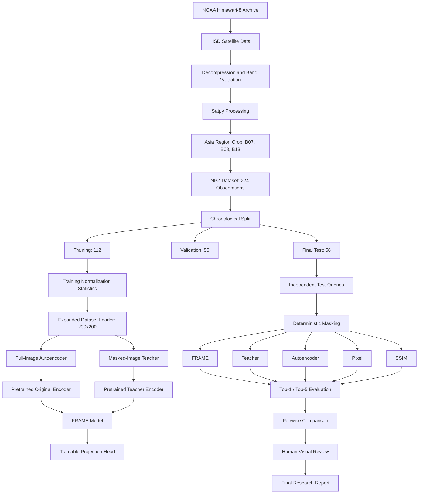
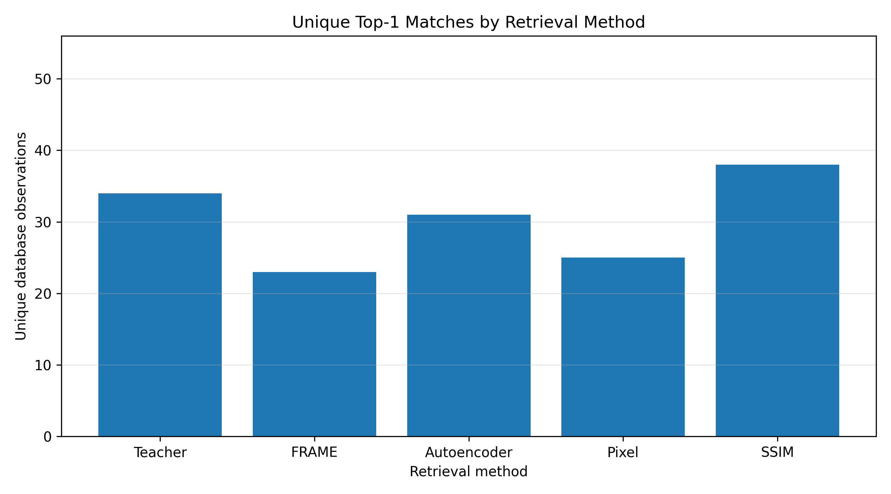
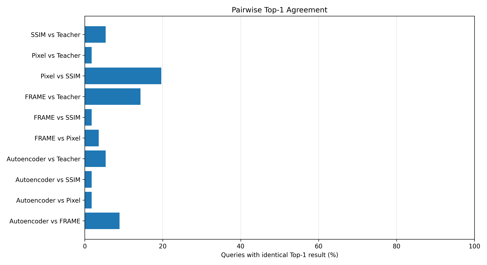
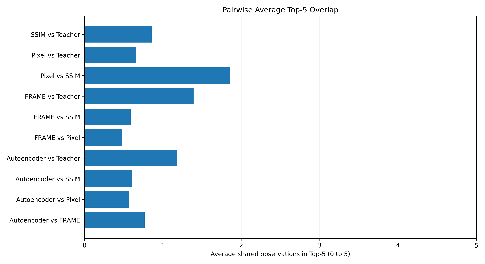
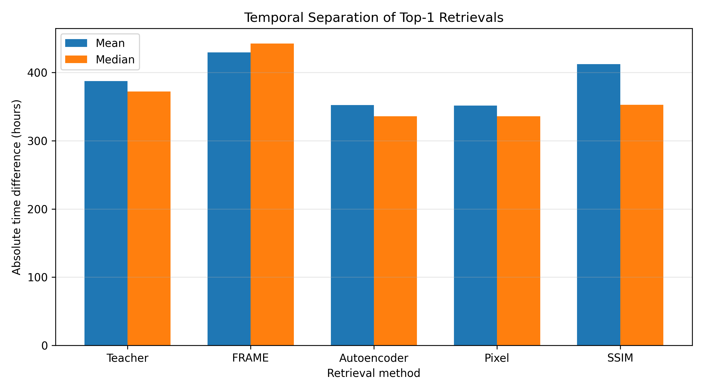

# FRAME: Satellite Image Retrieval

**Research title:** Efficient Reconstruction of Masked Image Embeddings for Region-Specific Satellite Image Retrieval

This project investigates region-specific satellite image retrieval using a Focus Region Aware Masking Embedding (FRAME) approach.

It is a modified reproduction and experimental extension using publicly available Himawari-8 satellite imagery instead of the COMS imagery used in the original research.

## 1. Research objective

The objective is to retrieve historical satellite observations that are visually similar to a specified region of interest in a query image.

Five retrieval approaches are investigated:

1. **Teacher** — masked-image encoder trained as an independent reconstruction model.
2. **FRAME** — predicts teacher embeddings using the original image representation and a spatial mask.
3. **Autoencoder** — full-image embeddings from a reconstruction-trained encoder.
4. **Pixel** — visible-region pixel-distance baseline.
5. **SSIM** — visible-region structural similarity baseline.

The experiments investigate whether masked-region embedding reconstruction can support satellite image retrieval.

## 2. Dataset

### Data source

- Satellite: Himawari-8 (AHI)
- Archive: NOAA public Himawari-8 archive
- Source: `s3://noaa-himawari8/AHI-L1b-FLDK/`
- Observation period: January 1–28, 2022
- Geographic region: Asia
- Longitude: 90°E–160°E
- Latitude: 10°S–60°N

### Satellite bands

| Band | Wavelength | Description |
|---|---|---|
| B07 | 3.9 µm | Shortwave infrared |
| B08 | 6.2 µm | Water vapour |
| B13 | 10.4 µm | Clean infrared window |

Each observation contains three bands. Source observations are processed to 1000 × 1000 pixels and resized to 200 × 200 for model input.

### Dataset split

The expanded dataset contains 224 observations sampled approximately every three hours.

| Split | Dates | Observations |
|---|---|---:|
| Training | January 1–14 | 112 |
| Validation | January 15–21 | 56 |
| Final test | January 22–28 | 56 |
| **Total** | **January 1–28** | **224** |

The observation `20220122_2050` replaces the unavailable January 22, 21:00 observation. Its original timestamp is preserved.

### Preprocessing

1. Download required Himawari-8 HSD segments.
2. Validate compressed source files.
3. Decompress HSD files.
4. Read B07, B08 and B13.
5. Resample the selected geographic region.
6. Save observations as NumPy NPZ files.
7. Calculate normalization statistics using training observations only.
8. Normalize and resize images for model input.

Dataset manifest:

`data/expanded_2022/metadata/expanded_dataset_manifest.csv`

Normalization statistics:

`data/expanded_2022/metadata/normalization_stats.json`
## 3. Model architecture

### Autoencoder

The autoencoder learns full-image representations through image reconstruction.

- SE residual encoder
- Three input channels
- 512-dimensional embedding
- Reconstruction decoder
- Mean squared error loss

### Masked teacher

The masked teacher receives an image with a randomly selected square region hidden.

It is trained to reconstruct the complete input image. Its encoder produces the target embeddings used during FRAME training.

The teacher was independently initialized and was not initialized from the trained autoencoder.

### FRAME

FRAME combines:

- Full-image embedding from the autoencoder encoder.
- Spatial mask embedding.
- Element-wise embedding interaction.
- Projection head that predicts the teacher embedding.

The autoencoder and teacher encoders are frozen during FRAME training.

FRAME is trained using cosine embedding loss against the masked teacher representation.

**Important:** The teacher is a learned training target, not ground-truth semantic relevance.

## 4. Training configuration

| Setting | Value |
|---|---|
| Random seed | 42 |
| Embedding dimension | 512 |
| Batch size | 2 |
| Initial learning rate | 0.001 |
| Autoencoder maximum epochs | 30 |
| Masked teacher maximum epochs | 30 |
| FRAME maximum epochs | 50 |
| Device | Apple Silicon MPS when available |
| Early stopping | Validation-loss based |

Training uses the training and validation splits. The final test dataset is not loaded during model training.

### Training scripts

- `scripts/train_expanded_autoencoder.py`
- `scripts/train_expanded_masked_encoder.py`
- `scripts/train_expanded_frame.py`

### Best checkpoints

- `checkpoints/expanded_2022/best_autoencoder.pth`
- `checkpoints/expanded_2022/best_masked_encoder.pth`
- `checkpoints/expanded_2022/best_frame_model.pth`

## 5. Final test evaluation

The final evaluation uses:

- Database: 112 training observations.
- Queries: 56 independent final-test observations.
- Validation observations: excluded from final scoring.

Five methods are evaluated:

1. Teacher
2. FRAME
3. Autoencoder
4. Pixel
5. SSIM

The evaluation records complete rankings, per-query results, method summaries, pairwise comparisons and temporal distances.

### Top-1 retrieval results

The following count represents the number of unique database observations selected as top-1 results across the 56 queries.

| Method | Queries | Unique top-1 matches |
|---|---:|---:|
| Teacher | 56 | 34 |
| FRAME | 56 | 23 |
| Autoencoder | 56 | 31 |
| Pixel | 56 | 25 |
| SSIM | 56 | 38 |

A larger number of unique top-1 matches indicates more diversity in selected database results. It does not establish better retrieval relevance.

### Pairwise agreement

| Comparison | Top-1 agreement | Average top-5 overlap |
|---|---:|---:|
| FRAME vs Teacher | 0.1429 | 1.3929 |
| FRAME vs Autoencoder | 0.0893 | 0.7679 |
| FRAME vs Pixel | 0.0357 | 0.4821 |
| FRAME vs SSIM | 0.0179 | 0.5893 |
| Pixel vs SSIM | 0.1964 | 1.8571 |

Average top-5 overlap is the number of shared observations in the two methods' top-five lists.

### Temporal separation

Mean temporal distance between each query and its top-1 retrieved observation:

| Method | Mean distance |
|---|---:|
| Autoencoder | 352.44 hours |
| FRAME | 429.53 hours |
| Pixel | 351.53 hours |
| SSIM | 412.28 hours |
| Teacher | 387.43 hours |

FRAME produced the largest mean temporal separation in this experiment. Temporal separation alone does not demonstrate meteorological or semantic relevance.

## 6. Human visual evaluation

A blinded visual-review pilot was conducted using:

- 10 randomly selected final-test queries.
- Five retrieval methods per query.
- Five retrieved candidates per method.
- 250 manually rated candidate images.

Rating scale:

| Score | Interpretation |
|---:|---|
| 0 | No meaningful visual similarity |
| 1 | Weak similarity |
| 2 | Moderate similarity |
| 3 | Strong similarity |

All 250 ratings were 2.

This means the pilot did not discriminate between methods. It does not establish that the methods have equal retrieval quality or that all results are objectively relevant.

The evaluation requires a more discriminative rubric and additional independent annotators.
### Top-1 retrieval results

The following count represents the number of unique database observations selected as top-1 results across the 56 queries.

| Method | Queries | Unique top-1 matches |
|---|---:|---:|
| Teacher | 56 | 34 |
| FRAME | 56 | 23 |
| Autoencoder | 56 | 31 |
| Pixel | 56 | 25 |
| SSIM | 56 | 38 |

A larger number of unique top-1 matches indicates more diversity in selected database results. It does not establish better retrieval relevance.

### Pairwise agreement

| Comparison | Top-1 agreement | Average top-5 overlap |
|---|---:|---:|
| FRAME vs Teacher | 0.1429 | 1.3929 |
| FRAME vs Autoencoder | 0.0893 | 0.7679 |
| FRAME vs Pixel | 0.0357 | 0.4821 |
| FRAME vs SSIM | 0.0179 | 0.5893 |
| Pixel vs SSIM | 0.1964 | 1.8571 |

Average top-5 overlap is the number of shared observations in the two methods' top-five lists.

### Temporal separation

Mean temporal distance between each query and its top-1 retrieved observation:

| Method | Mean distance |
|---|---:|
| Autoencoder | 352.44 hours |
| FRAME | 429.53 hours |
| Pixel | 351.53 hours |
| SSIM | 412.28 hours |
| Teacher | 387.43 hours |

FRAME produced the largest mean temporal separation in this experiment. Temporal separation alone does not demonstrate meteorological or semantic relevance.

## 6. Human visual evaluation

A blinded visual-review pilot was conducted using:

- 10 randomly selected final-test queries.
- Five retrieval methods per query.
- Five retrieved candidates per method.
- 250 manually rated candidate images.

Rating scale:

| Score | Interpretation |
|---:|---|
| 0 | No meaningful visual similarity |
| 1 | Weak similarity |
| 2 | Moderate similarity |
| 3 | Strong similarity |

All 250 ratings were 2.

This means the pilot did not discriminate between methods. It does not establish that the methods have equal retrieval quality or that all results are objectively relevant.

The evaluation requires a more discriminative rubric and additional independent annotators.
## 7. Results and reports

### Final evaluation outputs

- `results/expanded_2022/final_test_rankings.csv`
- `results/expanded_2022/final_test_per_query.csv`
- `results/expanded_2022/final_test_method_summary.csv`
- `results/expanded_2022/final_test_pairwise_comparison.csv`

### Blinded visual-review artifacts

Location:

`results/expanded_2022/blind_review/`

Important files:

- `blind_scoring_template.csv`
- `method_key.csv`
- `selected_queries.csv`

### Research reports

- `reports/FRAME_experiment_report.md`
- `reports/expanded_2022_final_test_report.md`

## 8. Project structure

```text
FRAME-Satellite-Retrieval/
│
├── scripts/
│   ├── models/
│   ├── download_expanded_28days.sh
│   ├── decompress_expanded_2022.sh
│   ├── process_expanded_2022.py
│   ├── prepare_expanded_stats.py
│   ├── expanded_satellite_dataset.py
│   ├── train_expanded_autoencoder.py
│   ├── train_expanded_masked_encoder.py
│   ├── train_expanded_frame.py
│   ├── evaluate_expanded_final_test.py
│   └── create_blind_visual_review.py
│
├── data/
│   └── expanded_2022/
│       ├── raw/
│       ├── processed/
│       ├── npz/
│       └── metadata/
│
├── checkpoints/
│   └── expanded_2022/
│
├── results/
│   └── expanded_2022/
│
├── reports/
│   ├── FRAME_experiment_report.md
│   └── expanded_2022_final_test_report.md
│
└── README.md
## 10. Limitations

1. The experiment covers one month of observations and one geographic region.
2. Only three Himawari-8 bands are used.
3. The dataset is relatively small for broad generalization claims.
4. The teacher is a learned reconstruction model, not a semantic relevance oracle.
5. Embedding agreement does not prove meteorological relevance.
6. The human visual-review pilot used one annotator and produced identical scores for all candidates.
7. The evaluation does not establish that FRAME outperforms the Pixel, SSIM, Teacher or Autoencoder baselines.
8. This is a modified reproduction using Himawari-8 rather than the original COMS dataset.

## 11. Future work

1. Expand the dataset across multiple seasons and years.
2. Evaluate additional geographic regions.
3. Investigate visible-image-aware mask conditioning.
4. Obtain meaningful relevance judgments from multiple independent annotators.
5. Evaluate Precision@5, Recall@5 and NDCG@5 when relevance labels are available.
6. Investigate cloud morphology and meteorological relevance.
7. Compare against additional satellite-image retrieval architectures.

## 12. Research integrity

The final test split is chronologically separate from training and validation. It was reserved for independent evaluation and was not used for model selection.

All reported results should be interpreted within the scope of this dataset, experimental design and evaluation protocol.

No method-superiority claim is made based solely on the current results.

---

## Citation and data attribution

Satellite observations are sourced from the NOAA public Himawari-8 archive:

https://registry.opendata.aws/noaa-himawari/

Himawari-8 is operated by the Japan Meteorological Agency (JMA).

This project is an independent research implementation and should not be interpreted as an official implementation of the original paper.


---

## Research Architecture

The following diagram illustrates the complete FRAME research workflow, from satellite data acquisition through independent retrieval evaluation.



---

## Final-Test Research Results

The retrieval evaluation uses 56 independent test queries from January 22–28, 2022, against a database of 112 training observations.

The following visualizations summarize retrieval diversity, pairwise method agreement, Top-5 overlap, and temporal separation.

### 1. Unique Top-1 Matches



### 2. Pairwise Top-1 Agreement



### 3. Pairwise Top-5 Overlap



### 4. Temporal Separation



**Interpretation:** These metrics describe retrieval diversity, ranking agreement, and temporal characteristics. They do not establish semantic relevance or prove that one retrieval method is superior.
