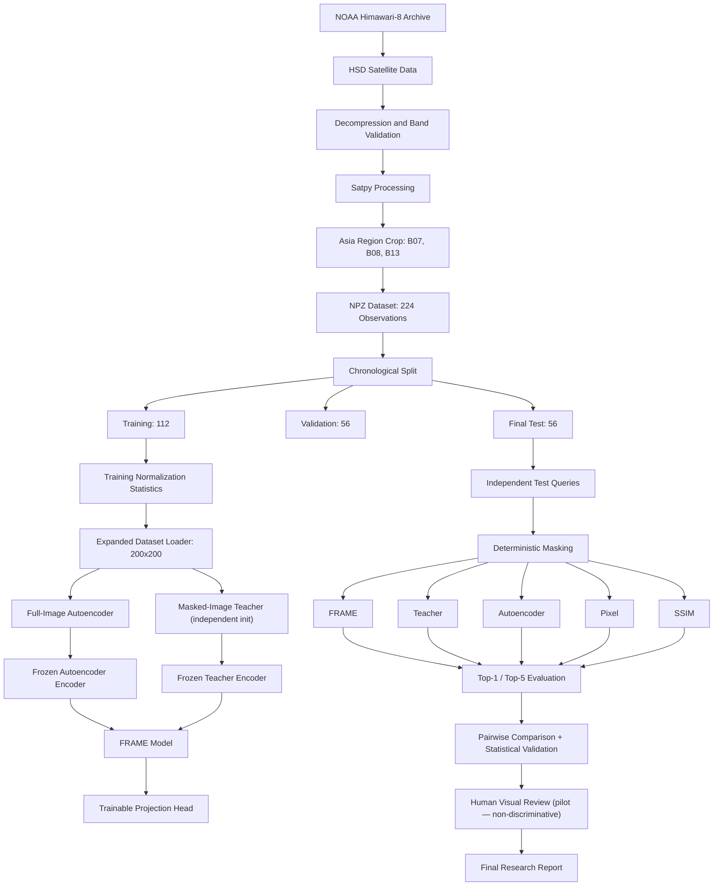

# FRAME: Satellite Image Retrieval

**Research title:** Efficient Reconstruction of Masked Image Embeddings for Region-Specific Satellite Image Retrieval

This project investigates region-specific satellite image retrieval using a Focus Region Aware Masking Embedding (FRAME) approach.

It is a modified reproduction and experimental extension using publicly available Himawari-8 satellite imagery instead of the COMS imagery used in the original research.

> **Important:** This project demonstrates a functioning satellite data and retrieval research pipeline and reports observed model behaviour. It does **not** prove that FRAME outperforms any baseline, nor does it establish semantic or meteorological retrieval relevance. All results should be treated as exploratory.

---

## 1. Research objective

The objective is to retrieve historical satellite observations that are visually similar to a specified region of interest in a query image.

Five retrieval approaches are investigated:

1. **Teacher** — masked-image encoder trained as an independent reconstruction model.
2. **FRAME** — predicts teacher embeddings using the original image representation and a spatial mask.
3. **Autoencoder** — full-image embeddings from a reconstruction-trained encoder.
4. **Pixel** — visible-region pixel-distance baseline.
5. **SSIM** — visible-region structural similarity baseline.

The experiments investigate whether masked-region embedding reconstruction can support satellite image retrieval.

---

## 2. Dataset

### Data source

- Satellite: Himawari-8 (AHI), operated by the Japan Meteorological Agency (JMA)
- Archive: NOAA public Himawari-8 archive
- Source: `s3://noaa-himawari8/AHI-L1b-FLDK/`
- Observation period: January 1–28, 2022
- Geographic region: Asia
- Longitude: 90°E–160°E
- Latitude: 10°S–60°N

### Satellite bands

Three infrared bands were selected to provide complementary atmospheric information:

| Band | Wavelength | Description | Scientific role |
|---|---|---|---|
| B07 | 3.9 µm | Shortwave infrared | Surface and cloud emission; reflected solar signal |
| B08 | 6.2 µm | Water vapour | Upper/mid-tropospheric moisture structure |
| B13 | 10.4 µm | Clean infrared window | Cloud-top and surface thermal emission patterns |

These bands are stacked into a three-channel tensor for convolutional model input. The resulting tensor is **not** a natural-colour image; it is a pseudo-colour infrared composite for visualization purposes only.

Each observation contains three bands. Source observations are processed to 1000 × 1000 pixels and resized to 200 × 200 for model input.

### Dataset split

The expanded dataset contains 224 observations sampled approximately every three hours.

| Split | Dates | Observations |
|---|---|---:|
| Training | January 1–14 | 112 |
| Validation | January 15–21 | 56 |
| Final test | January 22–28 | 56 |
| **Total** | **January 1–28** | **224** |

**Why chronological splitting?** Satellite imagery is time-series data. A random split could place near-adjacent observations from the same weather system in both training and test sets, making evaluation overly optimistic. A chronological split tests the ability to retrieve earlier observations for later query dates, as the system would be used in practice.

The observation `20220122_2050` replaces the unavailable January 22, 21:00 observation. Its original timestamp is preserved and it was not relabelled.

### Preprocessing

1. Download required Himawari-8 HSD segments.
2. Validate compressed source files.
3. Decompress HSD files.
4. Read B07, B08 and B13.
5. Resample the selected geographic region.
6. Save observations as NumPy NPZ files.
7. Calculate normalization statistics using **training observations only**.
8. Normalize and resize images for model input.

> **Leakage control:** Normalization statistics are derived from the 112 training observations only. Applying these training-derived statistics to all splits ensures that test data never influences preprocessing parameters.

Dataset manifest: `data/expanded_2022/metadata/expanded_dataset_manifest.csv`

Normalization statistics: `data/expanded_2022/metadata/normalization_stats.json`

---

## 3. Model architecture

### Autoencoder

The autoencoder learns full-image representations through image reconstruction. Its training objective is pixel-level reconstruction — not retrieval relevance.

- SE residual encoder
- Three input channels
- 512-dimensional embedding
- Reconstruction decoder
- Mean squared error loss
- 23,964,863 parameters

### Masked teacher

The masked teacher receives an image with a randomly selected square region hidden (side length 40–100 pixels on a 200×200 image). It is trained to reconstruct the complete original image, forcing the encoder to build representations that work from partial input.

The teacher was **independently initialized** and was not warm-started from the trained autoencoder.

Its encoder produces the target embeddings used during FRAME training.

> **Important:** The teacher is a learned reconstruction model, not a semantic relevance oracle. FRAME training minimises imitation of the teacher embedding. Low FRAME training loss only demonstrates successful imitation — not that FRAME retrieves meteorologically or semantically relevant scenes.

### FRAME

FRAME combines:

- Full-image embedding from the frozen autoencoder encoder.
- Spatial mask embedding.
- Element-wise embedding interaction.
- Trainable projection head that predicts the teacher embedding.

The autoencoder and teacher encoders are **frozen** during FRAME training.

FRAME is trained using cosine embedding loss against the masked teacher representation.

**Intuition:** FRAME takes a complete satellite image for full-scene context, applies a spatial mask to identify the region of interest, and produces a compact embedding that describes how that specific region looks. That embedding is compared to historical embeddings to retrieve the most similar past observation.

---

## 4. Training configuration

| Setting | Value |
|---|---|
| Random seed | 42 |
| Embedding dimension | 512 |
| Batch size | 2 |
| Initial learning rate | 0.001 |
| Autoencoder maximum epochs | 30 |
| Masked teacher maximum epochs | 30 |
| FRAME maximum epochs | 50 |
| Device | Apple Silicon MPS when available |
| Early stopping | Validation-loss based |

Training uses the training and validation splits only. The final test dataset is **not loaded** during model training or model selection.

### Training results

| Model | Best epoch | Best validation loss | Loss type |
|---|---:|---:|---|
| Autoencoder | 12 | 0.5264 | MSE (reconstruction) |
| Masked Teacher | 11 | 0.5305 | MSE (reconstruction) |
| FRAME | 12 | 0.0035 | 1 − cosine similarity |

> **Note on FRAME loss:** The low FRAME validation loss (0.0035) measures angular alignment to the teacher embedding. It is not Precision@K, Recall@K, NDCG, or a human relevance score and cannot be used to claim FRAME is better at retrieving relevant satellite scenes.

### Training scripts

- `scripts/train_expanded_autoencoder.py`
- `scripts/train_expanded_masked_encoder.py`
- `scripts/train_expanded_frame.py`

### Best checkpoints

- `checkpoints/expanded_2022/best_autoencoder.pth`
- `checkpoints/expanded_2022/best_masked_encoder.pth`
- `checkpoints/expanded_2022/best_frame_model.pth`

---

## 5. Final test evaluation

The final evaluation uses:

- Database: 112 training observations.
- Queries: 56 independent final-test observations.
- Validation observations: **excluded** from final scoring.

Five methods are evaluated:

| Method | Query representation | Database representation |
|---|---|---|
| Teacher | Masked-image teacher embedding | Full-image teacher embeddings |
| FRAME | FRAME projection of full image + mask | Full-image teacher embeddings |
| Autoencoder | Full-image autoencoder embedding | Full-image autoencoder embeddings |
| Pixel | Visible-region pixel values | Visible-region pixel values |
| SSIM | Visible-region structural similarity | Visible-region structural similarity |

### Top-1 retrieval diversity

The following count represents the number of unique database observations selected as top-1 results across the 56 queries. **This measures retrieval diversity, not retrieval quality.**

| Method | Queries | Unique top-1 matches |
|---|---:|---:|
| Teacher | 56 | 34 |
| FRAME | 56 | 23 |
| Autoencoder | 56 | 31 |
| Pixel | 56 | 25 |
| SSIM | 56 | 38 |

### Pairwise agreement

Top-1 agreement is the fraction of queries where both methods selected the same top result. **This measures ranking agreement, not which ranking is correct.**

| Comparison | Top-1 agreement | Average top-5 overlap |
|---|---:|---:|
| FRAME vs Teacher | 0.1429 | 1.3929 |
| FRAME vs Autoencoder | 0.0893 | 0.7679 |
| FRAME vs Pixel | 0.0357 | 0.4821 |
| FRAME vs SSIM | 0.0179 | 0.5893 |
| Pixel vs SSIM | 0.1964 | 1.8571 |

Average top-5 overlap is the number of shared observations in the two methods' top-five lists (range 0–5).

### Temporal separation

Mean temporal distance between each query and its top-1 retrieved observation:

| Method | Mean distance | Median distance |
|---|---:|---:|
| Pixel | 351.53 hours | 336.0 hours |
| Autoencoder | 352.44 hours | 336.0 hours |
| Teacher | 387.43 hours | 372.0 hours |
| SSIM | 412.28 hours | 352.5 hours |
| FRAME | 429.53 hours | 442.5 hours |

> **Important:** FRAME produced the largest mean temporal separation. This means FRAME tends to retrieve scenes that are farther back in time — it does **not** mean FRAME is better. Temporal distance is not equivalent to meteorological or semantic relevance. No pairwise temporal difference was statistically significant after Holm correction (minimum adjusted p-value: 0.1562).

---

## 6. Statistical validation

Statistical analysis script: `scripts/statistical_validation_v2.py`

### Methods used

| Test | Purpose | Limitation |
|---|---|---|
| Day-cluster bootstrap (10,000 reps) | 95% CI for temporal separation and Top-5 overlap | Only 7 daily clusters — intervals are exploratory |
| Paired Wilcoxon signed-rank | Test pairwise temporal differences | n=7 gives very limited power; large effects only detectable |
| Holm correction | Control family-wise error across 10 pairwise tests | Applied correctly |
| Wilson interval | 95% CI for Top-1 agreement proportions | Does not account for within-day query correlation |

> **Power warning:** With only 7 daily clusters, bootstrap intervals and Wilcoxon tests have limited statistical power. Non-significant results are expected even if real differences exist. All statistical findings should be treated as descriptive and exploratory.

### Temporal separation with 95% bootstrap CI

| Method | Mean (hours) | CI lower | CI upper |
|---|---:|---:|---:|
| Pixel | 351.53 | 328.61 | 373.92 |
| Autoencoder | 352.44 | 320.46 | 384.21 |
| Teacher | 387.43 | 354.37 | 419.46 |
| SSIM | 412.28 | 362.12 | 464.78 |
| FRAME | 429.53 | 388.82 | 476.04 |

No pairwise temporal difference was statistically significant at p < 0.05 after Holm correction.

---

## 7. Human visual evaluation

A blinded visual-review pilot was conducted using:

- 10 randomly selected final-test queries.
- Five retrieval methods per query.
- Five retrieved candidates per method.
- 250 manually rated candidate images.

Rating scale:

| Score | Interpretation |
|---:|---|
| 0 | No meaningful visual similarity |
| 1 | Weak similarity |
| 2 | Moderate similarity |
| 3 | Strong similarity |

**Result:** All 250 ratings were 2.

> **Interpretation:** Identical ratings across all 250 candidates mean the pilot produced **no discriminative data**. This does not mean all methods are equally good — it means the rubric, task design, and single-annotator protocol failed to separate them. These ratings cannot be used as evidence for or against any method.

**What a valid evaluation requires:**
- A clear rubric with example images anchoring each score level.
- Multiple independent annotators with measured inter-annotator agreement.
- Negative examples and calibration items.
- Randomised candidate order with hidden method labels.
- Computation of Precision@K, Recall@K, NDCG@K and mAP only after reliable labels are obtained.

---

## 8. Results and reports

### Final evaluation outputs

- `results/expanded_2022/final_test_rankings.csv`
- `results/expanded_2022/final_test_per_query.csv`
- `results/expanded_2022/final_test_method_summary.csv`
- `results/expanded_2022/final_test_pairwise_comparison.csv`

### Statistical validation outputs

- `results/expanded_2022/statistical_validation/temporal_bootstrap_ci.csv`
- `results/expanded_2022/statistical_validation/temporal_paired_tests.csv`
- `results/expanded_2022/statistical_validation/top1_agreement_wilson_ci.csv`
- `results/expanded_2022/statistical_validation/top5_overlap_bootstrap_ci.csv`

### Blinded visual-review artifacts

Location: `results/expanded_2022/blind_review/`

- `blind_scoring_template.csv`
- `method_key.csv`
- `selected_queries.csv`

### Research reports

- `reports/FRAME_experiment_report.md`
- `reports/expanded_2022_final_test_report.md`
- `reports/statistical_validation_report.md`

---

## 9. Project structure

```text
FRAME-Satellite-Retrieval/
│
├── scripts/
│   ├── models/
│   │   ├── se_res_autoencoder.py
│   │   ├── frame_model.py
│   │   └── ...
│   ├── download_expanded_28days.sh
│   ├── decompress_expanded_2022.sh
│   ├── process_expanded_2022.py
│   ├── prepare_expanded_stats.py
│   ├── expanded_satellite_dataset.py
│   ├── train_expanded_autoencoder.py
│   ├── train_expanded_masked_encoder.py
│   ├── train_expanded_frame.py
│   ├── evaluate_expanded_final_test.py
│   ├── create_blind_visual_review.py
│   └── statistical_validation_v2.py
│
├── data/
│   └── expanded_2022/
│       ├── raw/            # excluded from Git
│       ├── processed/      # excluded from Git
│       ├── npz/            # excluded from Git
│       └── metadata/
│
├── checkpoints/
│   └── expanded_2022/      # excluded from Git (large binary files)
│
├── results/
│   └── expanded_2022/
│
├── reports/
│   ├── FRAME_experiment_report.md
│   ├── expanded_2022_final_test_report.md
│   └── statistical_validation_report.md
│
├── requirements.txt
├── .gitignore
└── README.md
```

---

## 10. Reproduction steps

```bash
# 1. Set up environment
pip install -r requirements.txt

# 2. Download satellite data
bash scripts/download_expanded_28days.sh

# 3. Decompress HSD files
bash scripts/decompress_expanded_2022.sh

# 4. Process with Satpy (geospatial resampling → NPZ)
python scripts/process_expanded_2022.py

# 5. Compute training-only normalization statistics
python scripts/prepare_expanded_stats.py

# 6. Train models (in order)
python scripts/train_expanded_autoencoder.py
python scripts/train_expanded_masked_encoder.py
python scripts/train_expanded_frame.py

# 7. Run final evaluation (uses test split only)
python scripts/evaluate_expanded_final_test.py

# 8. Run statistical validation
python scripts/statistical_validation_v2.py
```

**Note:** Model checkpoints are excluded from the repository (large binary files). To reproduce exact results, rerun training from step 6.

---

## 11. Limitations

1. The experiment covers **one month** (January 2022) and one geographic region. Seasonal and interannual generalization are unknown.
2. Only **three Himawari-8 bands** are used. Other spectral channels may provide additional or complementary information.
3. The dataset is **small** (224 observations). This limits the statistical reliability of model training and evaluation.
4. The **masked teacher is a learned target**, not ground-truth semantic relevance. Low FRAME training loss only demonstrates imitation of the teacher.
5. **Temporal separation is not relevance.** Larger temporal distance does not mean a retrieved scene is more meteorologically or visually relevant.
6. **Unique Top-1 matches measure diversity**, not correctness.
7. **Top-1 agreement and Top-5 overlap measure method similarity**, not which method is correct.
8. The human visual pilot used **one annotator** and produced identical scores for all 250 candidates — no discriminative data was obtained.
9. With **only 7 daily clusters**, bootstrap intervals and Wilcoxon tests have very limited statistical power.
10. Wilson Top-1 agreement intervals assume independent queries and may understate uncertainty for same-day queries.
11. The mask shape (square, 40–100 px) was not ablated. Real regions of interest are rarely square.
12. This is a **modified reproduction** using Himawari-8 rather than the original COMS dataset.

---

## 12. Future work

1. Develop a discriminative relevance rubric with multiple independent annotators.
2. Compute Precision@K, Recall@K, NDCG@K and mAP after reliable labels are obtained.
3. Expand data across multiple months, seasons, and years.
4. Evaluate additional geographic regions.
5. Ablate mask size, mask shape, and projection head design.
6. Repeat training with multiple random seeds to measure variability.
7. Compare against stronger satellite-image retrieval baselines.
8. Write a formal research paper once evidence is sufficiently strengthened.

---

## 13. Research integrity

The final test split is chronologically separate from training and validation. It was reserved for independent evaluation and was **not** used for model selection.

No method-superiority claim is made based on the current results.

The current project should be presented as a **modified reproduction and exploratory experimental baseline**. It demonstrates a functioning satellite data and retrieval research pipeline. It does not prove that FRAME outperforms baselines or retrieves semantically or meteorologically more relevant scenes.

---

## Citation and data attribution

Satellite observations are sourced from the NOAA public Himawari-8 archive:

https://registry.opendata.aws/noaa-himawari/

Himawari-8 is operated by the Japan Meteorological Agency (JMA).

This project is an independent research implementation and should not be interpreted as an official implementation of the original paper.

---

## Research Architecture

The following diagram illustrates the complete FRAME research workflow, from satellite data acquisition through independent retrieval evaluation.



---

## Final-Test Research Results

The retrieval evaluation uses 56 independent test queries from January 22–28, 2022, against a database of 112 training observations.

The following visualizations summarize retrieval diversity, pairwise method agreement, Top-5 overlap, and temporal separation.

### 1. Unique Top-1 Matches


### 2. Pairwise Top-1 Agreement


### 3. Pairwise Top-5 Overlap


### 4. Temporal Separation


**Interpretation:** These metrics describe retrieval diversity, ranking agreement, and temporal characteristics. They do not establish semantic relevance or prove that one retrieval method is superior. No pairwise temporal difference was statistically significant after multiple-comparison correction.
